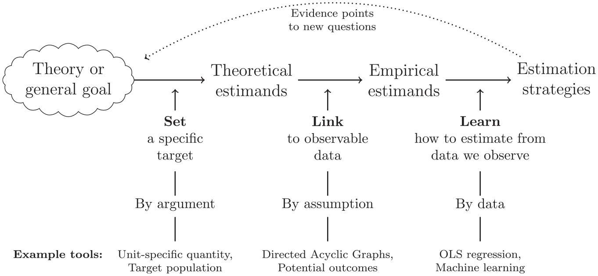
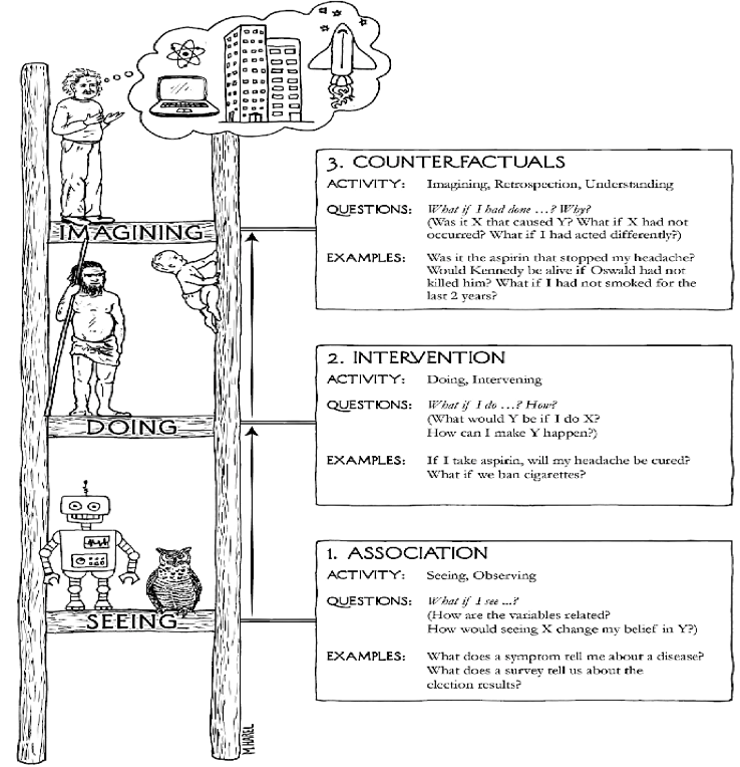

# Motivation {background-color="#002147"}

\newcommand\indep{\perp\!\!\!\perp}
\newcommand\nindep{\not\!\perp\!\!\!\perp}


## Why should we care about causal inference?

. . .

<br>
The social sciences are experimenting what some authors have described as the rise of "causal empiricism" (Samii, 2016), a "credibility revolution" (Angrist and Pischke, 2010), or simply a "causal revolution" (Pearl and MacKenzie, 2018)

. . .

In artificial intelligence/ML, causality have been deemed [**"the next frontier"**](https://phys.org/news/2019-02-causal-disentanglement-frontier-ai.html) and [**"the next most important thing"**](https://www.datasciencecentral.com/profiles/blogs/causality-the-next-most-important-thing-in-ai-ml)

. . .

The enormous progress in the last decades has been facilitated by the development of mathematical frameworks that provide researchers with tools to handle causal questions: [Potential Outcomes]{.fragment .highlight-red} and the [Structural Causal Model]{.fragment .highlight-red}

---


## What should you expect from this class?

<br>

This class is designed as a first course in causal inference, so we can focus only on a few things:

* Familiarize yourself with the most widely used causal inference frameworks

* Understand the role of randomisation to tackle causal questions

* Use potential outcomes and the do-operator to formalize causal estimands

* Use directed acyclic graphs (DAGs) to encode qualitative assumptions

* Derive identification results and testable implications from a DAG 

* Assess the plausibility of different identification strategies applied to real problems


## But, first: What is your estimand?

Researchers, at least social scientists, tend to formalize their effect of interest as **regression coefficients** (i.e., their hypothesis are formulated within a statistical model)

[[**This is too restrictive!**]()]{.fragment .fade-in}

. . . 

Potential outcomes offer a way to formalize what we mean by a *causal effect* outside any statistical model. Graphical models provides a way to formalize our *assumptions* without parametric restrictions.

. . .

This allows us to clearly separate *what do we want* (a certain **estimand**), what needs to be true so we get what we want (**identifying assumptions**), the statistical machinery to transform data into an answer for our question (an **estimator**), and the particular answer we get (our empirical **estimate**).

:::{.aside}
Lundberg, Johnson, and Stewart (2021) discuss this point in great detail [[link]](https://journals.sagepub.com/doi/10.1177/00031224211004187)
:::

## But, first: What is your estimand?


<br>

{fig-align="center" width=70%}


# What is causal inference about? {background-color="#002147"}


## Intuitions about causality

### Have you heard any of these before?

<br>

"Correlation does not imply causation"


:::{.fragment .r-stack}
*But can we go from one to the other?*
:::


"No causation without manipulation"


:::{.fragment .r-stack}
*Then what about race or gender?*
:::


"Causal inference is a missing data problem"


:::{.fragment .r-stack}
*Or is it the other way around?*
:::


"For causal inference, design trumps analysis"


:::{.fragment .r-stack}
*But what do we mean by design? And analysis?*
:::


## Statistics/ML vs Causal Inference

::: {.columns}

::: {.column width="50%"}
***Statistics/ML***

+ Passive observation of the data generating process
+ Estimand: Joint probabilities, CEF
$$P(Y,X)$$
$$E(Y|X=x)$$
+ Focus on asymptotics / out of sample prediction
+ Estimation problem: variance-bias tradeoff
+ Pearl: "deep learning is just curve fitting"
:::

::: {.column width="50%"}
***Causal Inference***

+ Prediction **under interventions** on the DGP
+ Estimand: interventional quantities
$$P(Y|do(x))$$ 
$$E(Y|do(x)) - E(Y|do(x'))$$ 
$$= E(Y_x) - E(Y_{x'})$$
+ Identification problem: consistency (infinite sample)
+ Estimation problem: in general, focus on bias over variance (but changing)
:::

:::
---

## The ladder of causation

{fig-align="center" width=50%}

:::{.aside}
Drawing by Maayan Harel, TBOW
:::


## The ladder of causation {background-color="#002F87"}

:::{.panel-tabset}

## Association

| Estimand | Activity | Field/Discipline | Questions | Example |
| ---- | --- | --- | ----- | ------ |
| $\mathbf{P(Y \vert X)}$ | Seeing, Observing | Stats, Machine Learning | *What would I believe about Y if I see X?* | What is the expected income of a college graduate in a given field? |

## Interventions
| Estimand | Activity | Field/Discipline | Questions | Example |
| --- | --- | --- | ----- | ------ |
| $\mathbf{P(Y \vert do(x))}$ | Doing, Intervening | Experiments, Policy evaluation | *What would happen with Y if I change X?* | How would income levels change in response to college expansion? |

## Counterfactuals

| Estimand | Activity | Field/Discipline | Questions | Example |
| --- | --- | --- | ----- | ------ |
| $\mathbf{P(Y_x \vert x',y')}$ | Imagining, Retrospecting | Structural Models | *What would have happened with Y have I done X instead of X'? Why?* | What would have my parents' income been, have they graduated from college, given that they didn't go?| 
:::

::: aside
Pearl and Mackenzie (2018)
:::


## But, is **doing** *really* that different from **seeing**? 

<br>

{width="900" fig-align="center"}

:::aside
[causality](https://imgs.xkcd.com/comics/correlation.png)
:::

---


## Is **doing** *really* that different from **seeing**?

Let's imagine an example: we want to know the effect of the selectivity of the graduate program a student attends on the quality of their first job after graduation

. . .

::: {.columns}

::: {.column width="40%"}
```{r, echo=TRUE}
set.seed(1988)

# sample size
N <- 1000

# student "potential"
W <- rnorm(N, mean=25, sd=50) 

# program selectivity
X <- 0.6*W + rnorm(N, mean=0, sd=15)

# quality of first job
Y <- 0.4*W - 0.2*X + rnorm(N, mean = 0, sd = 25)

# store everything
data <- data.frame(Y=Y, X=X, W=W)
```
:::

:::{.column width="60%"}
```{r, echo=FALSE, out.width='120%', cache=FALSE}
library(ggplot2)
ggplot2::ggplot(data, aes(x=X, y=Y)) +
  geom_point(alpha=0.2) +
  labs(x = "Selectivity of graduate program index",
       y = "Quality of first job index") +
  scale_y_continuous(limits = c(-100,150)) +
  #scale_x_continuous(limits = c(-100,150)) +
  theme_bw()
```
:::

:::
---


## Is **doing** *really* that different from **seeing**?

Then, let's see what story a simple linear regression would tell

. . . 

:::{.columns}

:::{.column width="40%"}

```{r, cache = FALSE}
# Bivariate regression

lm(Y~X, data=data)
```

:::{.callout-warning}
However, we know that the true effect is negative!
:::

:::

:::{.column width="60%"}
```{r, echo=FALSE, out.width='120%', cache= FALSE}
ggplot2::ggplot(data, aes(x=X, y=Y)) +
  geom_point(alpha=0.2) +
  geom_smooth(method="lm", color="red") +
  labs(x = "Selectivity of graduate program index",
       y = "Quality of first job index") +
  scale_y_continuous(limits = c(-100,150)) +
  #scale_x_continuous(limits = c(-100,150)) +
  theme_bw()
```
:::

:::
---


## Is **doing** *really* that different from **seeing**?


What if we instead randomize students to different programs?

. . .

:::{.columns}

:::{.column width="40%"}

```{r, cache = FALSE, echo=TRUE}
# let's simulate random assignment 
# of students to programs!

data$Xrand <- sample(min(X):max(X),
            N, replace=TRUE)

# now add quality of first job

data$Yexp <- 0.4*W - 0.2*data$Xrand + rnorm(N, mean = 0, sd = 25)

lm(Yexp~Xrand, data=data)
```
:::

:::{.column widht="60%"}
```{r, echo=FALSE, out.width='120%', cache = FALSE}
ggplot2::ggplot(data, aes(x=Xrand, y=Yexp)) +
  geom_point(alpha=0.2) +
  geom_smooth(method="lm", color="red") +
  labs(x = "Selectivity of graduate program index",
       y = "Quality of first job index") +
  scale_y_continuous(limits = c(-100,150)) +
  #scale_x_continuous(limits = c(-100,150)) +
  theme_bw()
```

:::{.callout-note}
Now we can see the true effect!
:::

:::

:::


---


## Is **doing** *really* that different from **seeing**?

Can we fix the observational comparison by adjusting for $W$?

. . . 

:::{.columns}

:::{.column width="40%"}
```{r, cache = FALSE, echo=TRUE}
# Same regression
# Plus "adjustment" for student potential
reg <- lm(Y~X+W, data=data)

# By FWL theorem, we can replicate
# this results with bivariate regs
# Run the bivariate regression and save the residuals
regresids <- broom::augment(lm(X ~ W, data = data))

reg
```
:::

:::{.column width="60%"}
```{r, echo=FALSE, out.width='120%', cache =FALSE}
# Plot
ggplot(data = regresids, 
       aes(y = data$Y, x = .resid)) +
  geom_point(alpha = 0.2) + 
  geom_smooth(method="lm", color="red") +
  theme_bw() + 
  scale_y_continuous(limits = c(-100,150)) +
  #scale_x_continuous(limits = c(-100,150)) +
  labs(x = "Selectivity of graduate program index (adjusting for student potential)",
       y = "Quality of first job index (predicted)")
```
:::

:::

---

## Is **doing** *really* that different from **seeing**?

Where are we getting the data from? 

Imagine we collected the data by looking at programs' websites, where they post the job market outcomes but 

* more selective programs tend to report more
* students will report to their programs based partially on the quality of their job offers

. . .

:::{.columns}

:::{.column width="40%"}

```{r, cache = TRUE, echo = TRUE}
# Registry of job market candidates
# As a function of selectivity and outcome
prob <- 1/(1+exp(-(1.5*X+Y*2)))
data$C <- rbinom(N, 1, prob=prob)

# What would happen if we change the probs?
# prob <- 1/(1+exp(-(X-Y*2)))

lm(Y ~ X + W, data=subset(data, C==1))
```
:::


:::{.column width="60%"}
```{r, echo=FALSE, out.width='120%', cache = FALSE}
regresids <- broom::augment(lm(X ~ W, data = data))
data$Xres <- regresids$.resid

ggplot2::ggplot(data,
                aes(x=Xres, y=Y, color = factor(C))) +
  geom_point(alpha=0.2) +
  geom_smooth(method="lm", color="red",
              data = subset(data, C==1),
              aes(y = Y,
                  x = Xres)) +
  labs(x = "Selectivity of graduate program index",
       y = "Quality of first job index") +
  scale_y_continuous(limits = c(-100,150)) +
  #scale_x_continuous(limits = c(-100,150)) +
  theme_bw()

#regresids <- broom::augment(lm(X ~ W, data = subset(data, C==1)))
# ggplot2::ggplot(data, 
#                 aes(x=X, y=Y, color = factor(C))) +
#   geom_point(alpha=0.2) +
#   geom_smooth(method="lm", color="red", 
#               data = regresids,
#               aes(y = data[data$C==1, "Y"], x = .resid)) +
#   labs(x = "Selectivity of graduate program index",
#        y = "Quality of first job index") +
#   scale_y_continuous(limits = c(-100,150)) +
#   #scale_x_continuous(limits = c(-100,150)) +
#   theme_bw()
```
:::

:::

---

The last piece was an example of so-called "selection bias".

:::{.r-stack}
{.fragment width="600"}

{.fragment width="900"}
:::


:::aside
[selection bias](https://www.explainxkcd.com/wiki/images/9/9b/selection_bias.png)

[confounding](https://imgs.xkcd.com/comics/confounding_variables.png)
:::


# From causal methods to causal assumptions {background-color="#002147"}


## From causal methods to causal assumptions

It is common to hear the idea that some *methods* are inherently causal: propensity score matching, IPW, instrumental variables, panel methods, and even machine learning

But there is nothing properly causal about a method (i.e, an estimator, an algorithm, a formula)!

What makes our conclusions causal is the assumptions we make, whose plausibility is justified (or not) on a given research design


## From causal methods to causal assumptions

In this first lecture, we are going to study the formal language that allows us to clearly and transparently state both our quantities of interest and our assumptions

Then we will **see** this framework in action, to understand how does it work in the context of randomised studies

We should be able to understand why RCTs are often described as the "gold standard" for causal inference

## The First Commandment of Causal Inference {background-color="#692044"}

:::{.fragment}

### (by Chad Hazlett)

::: callout-warning
Thou shalt not blindly apply identification strategies as if the *procedure* makes your results causal
:::

:::
. . .

Identification strategies are about assumptions, not tools:

-   learning tools is important, useful, and fun

-   but the tool you use doesn't make your result causal, your assumptions do

-   most of your effort should go into understanding and communicating whether your assumptions are credible

. . .

::: callout-note
## Corolary: Never say "my estimate is causal because I used (.)"

Where (.) = matching, IPW, IV, RDD, DML, whatever
:::


# Potential Outcomes {background-color="#17a091"}

## Neyman, Neyman-Rubin, or Rubin Causal Model (?)

<br>

POs were introduced by Neyman (1923) in the context of experimental design. They remained only used in that context for decades!

-   Imported and extended by Donald Rubin for observational studies (c. 1974)

-   They are really great to clarify *what do we want to know* ([[**estimand**]()]{.fragment .fade-in})

-   This includes identifying *reasons for discrepancies* between what we observe and our estimand ([[**bias**]()]{.fragment .fade-in})

-   They are great to formalize *what needs to be true* for our estimand to be identified with a given *estimator* ([[**assumptions**]()]{.fragment .fade-in})

. . .

-   They are not-so-great to assess if our assumptions are plausible or defensible (more on this later!)

------------------------------------------------------------------------

## Notation

To think *causally*, we need to go [beyond]{style="color:red;"} what we can observe. We need to hypothesize about possible worlds (*what if*s)!

. . .

To do this, let's *postulate* the existence of [potential outcomes]{style="color:red;"}

<br>

Let's start with some definitions:

. . .

$Y$ is the outcome variable *as we observe it*

$D$ is the variable whose effect we want to study (treatment, exposure)

$Y_d$ is the potential outcome when we [**set**]{.fragment .highlight-red} $D=d$. For example, when $D \in \{0,1\}$:

-   $Y_1$ is the potential outcome under "treatment"

-   $Y_0$ is the potential outcome under "control"

------------------------------------------------------------------------

## Notation

You will find a lot of equivalent notations for potential outcomes. It could be confusing, but it is good to get practice working with different variants

$$Y(d) = Y_d = Y^d$$

. . .

::: callout-tip
## Read it like this:

The value that the variable $Y$ would take if we were to set/manipulate the variable $D$ to the value $d$.
:::

::: {.fragment .r-stack}
What is the [*fundamental problem*]{style="color:red;"} of causal inference? (Holland, 1986)
:::

::: {.fragment .r-stack}
*Can you ever observe any of those potential outcomes?*
:::

::: {.fragment .r-stack}
*"Causal inference is a missing data problem"*
:::

## Notation

**Consistency** (also known as SUTVA): $$D = d \rightarrow Y = Y_d$$

For the binary treatment case, we have: $$Y = DY_1 + (1-D)Y_0$$ (a.k.a., "switching equation")

. . .

::: callout-note
What are the assumptions built in this notation? What type of dependence are we ruling out?
:::

------------------------------------------------------------------------

## Causal estimands

The first thing that potential outcomes allow us to do is to formalize the causal effects we may want to estimate.

Some frequently invoked estimands are the following: 

<br>

[[Individual treatment effect]{style="color:blue;"}
$$ITE = \tau_i = Y_{1i} - Y_{0i}$$]{.fragment .fade-in}

. . .

* How can we read this expression?
* Can we ever estimate it from data?

## Causal estimands

The first thing that potential outcomes allow us to do is to formalize the causal effects we may want to estimate.

Some frequently invoked estimands are the following: 

<br>


[Average treatment effect]{style="color:blue;"}
$$
ATE = E[\tau_i] = E[Y_{1i} - Y_{0i}]$$ $$= E[Y_{1i}] - E[Y_{0i}]
$$

. . .

* How can we read this expression?
* Can we ever estimate it from data?

## Causal estimands

The first thing that potential outcomes allow us to do is to formalize the causal effects we may want to estimate.

Some frequently invoked estimands are the following:

<br>

[Average treatment effect on the treated]{style="color:blue;"}
$$
ATT = E[\tau_i|D_i=1] = E[Y_{1i} - Y_{0i}|D_i=1]$$ $$= E[Y_{1i}|D_i=1] - E[Y_{0i}|D_i=1]
$$

. . .

* How can we read this expression?
* Can we ever estimate it from data?

## Causal estimands

The first thing that potential outcomes allow us to do is to formalize the causal effects we may want to estimate.

Some frequently invoked estimands are the following:

<br>


[Average treatment effect on the controls]{style="color:blue;"}
$$
ATC = E[\tau_i|D_i=0] = E[Y_{1i} - Y_{0i}|D_i=0]$$ $$= E[Y_{1i}|D_i=0] - E[Y_{0i}|D_i=0]
$$

. . .

* How can we read this expression?
* Can we ever estimate it from data?

## Causal estimands

The first thing that potential outcomes allow us to do is to formalize the causal effects we may want to estimate.

Some frequently invoked estimands are the following:

<br>

[Conditional average treatment effect]{style="color:blue;"}
$$
CATE = E[\tau_i|X_i=x] = E[Y_{1i} - Y_{0i}|X_i=x]$$ $$= E[Y_{1i}|X_i=x] - E[Y_{0i}|X_i=x]
$$

. . .

* How can we read this expression?
* Can we ever estimate it from data?


## Checking intuitions

Let's assume $D$ (the exposure) is defined as "doing the required readings before lecture", and $Y$ is "understanding what is going on". Then,

. . .

$$E[Y_{1i}] = E[Y_i | D_i=1]?$$

. . .

* Let's try to parse this out:

  + What is the individual quantity we are looking at?
  
  + What is the population we are targeting?
  
  + How would the observed $Y_{1i}$ (for those with $D_i=1$) compare to the $Y_{1i}$ you don't see?
  
  + [**When**]{style="color:red;"} would these two quantities be equivalent?
  

## Checking intuitions

Let's assume $D$ (the exposure) is defined as "doing the required readings before lecture", and $Y$ is "understanding what is going on". Then,


$$E[Y_{1i}] = E[Y_i | D_i=1]?$$


* If we throw $D_i$ at random in this room:

  + How would the observed $Y_{1i}$ (for those with $D_i=1$) compare to the $Y_{1i}$ you don't see?
  
  + What about the $Y_{0i}$?
  
  + Can we estimate $E[Y_1]$ and $E[Y_0]$?
  
## Checking intuitions

Let's assume $D$ (the exposure) is defined as "doing the required readings before lecture", and $Y$ is "understanding what is going on". Then,


$$E[Y_{1i}] = E[Y_i | D_i=1]?$$


* Suppose $Y_{1i} = Y_{0i}$ for everyone, and I can see them all:

  + What happens if I give $D_i=1$ more often to those with higher $Y_1$?
  
  + How would the $Y_1$ you see vs the $Y_1$ you don't see relate?
  
  + What would $E[Y_i|D_i=1] - E[Y_i | D_i=0]$ tell me?


## Short activity (3 mins) {background-color="#692044"}


Take a moment to think about your own research:

-   What **causal** question is relevant for you to study?
-   Can you formulate it using potential outcomes?
  + What is the contrast of interest?
  + Averaging over which sub-population?
-   What are the assumptions your are making in this formalization?

------------------------------------------------------------------------

## The Science Table

```{r, echo=FALSE}
data <- 
  data.frame(D=c(rep("A",5),rep("B",5)),
         Ya=c(1,0,0,1,1,1,1,0,0,1),
         Yb=c(1,0,1,0,1,0,0,0,1,1),
         W=c("quant","quant","qual","quant","qual",
             "qual","quant","qual","qual","quant")) |> 
  dplyr::mutate(Y = ifelse(D=="A",Ya,Yb))

ATE <- mean(data$Ya-data$Yb)
ATE_qual <- mean(data$Ya[data$W=="qual"]) -
  mean(data$Yb[data$W=="qual"])
ATE_quant <- mean(data$Ya[data$W=="quant"]) -
  mean(data$Yb[data$W=="quant"])
DIM <- mean(data$Y[data$D=="A"]) - mean(data$Y[data$D=="B"])
DIM_quant <- mean(data$Y[data$D=="A" & data$W=="quant"]) - 
  mean(data$Y[data$D=="B" & data$W=="quant"])
DIM_qual <- mean(data$Y[data$D=="A" & data$W=="qual"]) - 
  mean(data$Y[data$D=="B" & data$W=="qual"])
weights_quant <- sum(data$W=="quant")/nrow(data)
weights_qual <- sum(data$W=="qual")/nrow(data)
DIM_w <- DIM_quant*weights_quant + DIM_qual*weights_qual
```

::: columns
::: {.column width="50%"}
One advantage of PO is that we can treat them directly as random variables!

So, everything we already know related to probability manipulation still applies here.

The basic calculation device (usually implicit) for that matter is the **science table**.

Basically, the full schedule response of the potential outcomes under different treatment conditions
:::

::: {.column width="50%"}
| Unit | $D_i$ | $Y_i$ | $Y_{ai}$ | $Y_{bi}$ | $\tau_i$ |
|------|-------|-------|----------|----------|----------|
| 1    | A     | 1     | 1        | 1        | 0        |
| 2    | A     | 0     | 0        | 0        | 0        |
| 3    | A     | 0     | 0        | 1        | -1       |
| 4    | A     | 1     | 1        | 0        | 1        |
| 5    | A     | 1     | 1        | 1        | 0        |
| 6    | B     | 0     | 1        | 0        | 1        |
| 7    | B     | 0     | 1        | 0        | 1        |
| 8    | B     | 0     | 0        | 0        | 0        |
| 9    | B     | 1     | 0        | 1        | -1       |
| 10   | B     | 1     | 1        | 1        | 0        |
:::
:::

## Average Treatment Effect

::: columns
::: {.column width="50%"}
Imagine we want to compare two educational programs, $a$ and $b$.

We are interested in the employment status of their graduates after a year ($Y$)

The causal effect of the program would be the comparison of the potential outcomes $Y_{ai}$ and $Y_{bi}$, for all units $i$

$$\text{ATE} = E(Y_{ai}) - E(Y_{bi})$$ $$(6/10) - (5/10) = \mathbf{\color{blue}{0.1}}$$
:::

::: {.column width="50%"}
| Unit | $D_i$ | $Y_i$ | $Y_{ai}$ | $Y_{bi}$ | $\tau_i$ |
|------|-------|-------|----------|----------|----------|
| 1    | A     | 1     | 1        | 1        | 0        |
| 2    | A     | 0     | 0        | 0        | 0        |
| 3    | A     | 0     | 0        | 1        | -1       |
| 4    | A     | 1     | 1        | 0        | 1        |
| 5    | A     | 1     | 1        | 1        | 0        |
| 6    | B     | 0     | 1        | 0        | 1        |
| 7    | B     | 0     | 1        | 0        | 1        |
| 8    | B     | 0     | 0        | 0        | 0        |
| 9    | B     | 1     | 0        | 1        | -1       |
| 10   | B     | 1     | 1        | 1        | 0        |
:::
:::

------------------------------------------------------------------------

## Difference-in-means

::: columns
::: {.column width="50%"}
But we don't observe all potential outcomes for all units!

Can we use instead the observational comparison as a proxy?

Let's calculate the different in means across groups, based on the *actual* program each subject attended:

$$\text{diff-in-means} = E(Y_i|D=a) - E(Y_i|D=b)$$ $$(3/5)-(2/5) = \mathbf{\color{red}{0.2}}$$

$$\color{red}{\text{diff-in-means} \neq \text{ATE}}$$

$\color{red}{\text{But why???}}$
:::

::: {.column width="50%"}
| Unit | $D_i$ | $Y_i$ | $Y_{ai}$ | $Y_{bi}$ | $\tau_i$ |
|------|-------|-------|----------|----------|----------|
| 1    | A     | 1     | 1        | .        | .        |
| 2    | A     | 0     | 0        | .        | .        |
| 3    | A     | 0     | 0        | .        | .        |
| 4    | A     | 1     | 1        | .        | .        |
| 5    | A     | 1     | 1        | .        | .        |
| 6    | B     | 0     | .        | 0        | .        |
| 7    | B     | 0     | .        | 0        | .        |
| 8    | B     | 0     | .        | 0        | .        |
| 9    | B     | 1     | .        | 1        | .        |
| 10   | B     | 1     | .        | 1        | .        |
:::
:::

------------------------------------------------------------------------

## Sources of bias

::: columns
::: {.column width="50%"}
$$E(\text{diff-in-means})$$ $$= E(Y_i|D=a) - E(Y_i|D=b)$$ $$= E(Y_a|D=a) - E(Y_b|D=b)$$ $$= ATE +$$ $$(E[Y_b|D=a] - E[Y_b|D=b])+$$ $$(1-P[D])(ATT-ATC)$$ $$= \mathbf{\color{blue}{0.1}} + \color{red}{0.2 + (0.5)(-0.2) = \mathbf{0.2}}$$
:::

::: {.column width="50%"}
| Unit | $D_i$ | $Y_i$ | $Y_{ai}$ | $Y_{bi}$ | $\tau_i$ |
|------|-------|-------|----------|----------|----------|
| 1    | A     | 1     | 1        | .        | .        |
| 2    | A     | 0     | 0        | .        | .        |
| 3    | A     | 0     | 0        | .        | .        |
| 4    | A     | 1     | 1        | .        | .        |
| 5    | A     | 1     | 1        | .        | .        |
| 6    | B     | 0     | .        | 0        | .        |
| 7    | B     | 0     | .        | 0        | .        |
| 8    | B     | 0     | .        | 0        | .        |
| 9    | B     | 1     | .        | 1        | .        |
| 10   | B     | 1     | .        | 1        | .        |
:::
:::

------------------------------------------------------------------------

## Identification assumptions

::: columns
::: {.column width="50%"}
We need the following condition to be true: $$
Y_d \perp\!\!\!\perp D 
$$

Do we meet that condition here? No! $$(Y_{ai},Y_{bi}) \not\!\perp\!\!\!\perp D$$

Because: $$P(Y_a = y | D=a) \neq P(Y_a = y)$$ $$P(Y_b = y | D=b) \neq P(Y_b = y)$$
:::

::: {.column width="50%"}
| Unit | $D_i$ | $Y_i$ | $Y_{ai}$ | $Y_{bi}$ | $\tau_i$ |
|------|-------|-------|----------|----------|----------|
| 1    | A     | 1     | 1        | 1        | 0        |
| 2    | A     | 0     | 0        | 0        | 0        |
| 3    | A     | 0     | 0        | 1        | -1       |
| 4    | A     | 1     | 1        | 0        | 1        |
| 5    | A     | 1     | 1        | 1        | 0        |
| 6    | B     | 0     | 1        | 0        | 1        |
| 7    | B     | 0     | 1        | 0        | 1        |
| 8    | B     | 0     | 0        | 0        | 0        |
| 9    | B     | 1     | 0        | 1        | -1       |
| 10   | B     | 1     | 1        | 1        | 0        |
:::
:::

------------------------------------------------------------------------

## Identification assumptions

::: columns
::: {.column width="50%"}
What about including another covariate $W$?

Does the following condition holds? $$
Y_d \perp\!\!\!\perp D | W
$$

Not quite either! But still "better" than before, right? right?

Let's define: $$\text{CATE}_{w} = E(Y_a-Y_b|W=w)$$

and the estimator $\widehat{\text{CATE}}_{w} =$ $$E(Y_i|X=a,W=w) - E(Y_i|X=b,W=w)$$
:::

::: {.column width="50%"}
| Unit | $D_i$ | $Y_i$ | $Y_{ai}$ | $Y_{bi}$ | $\tau_i$ | $W_i$ |
|------|-------|-------|----------|----------|----------|-------|
| 1    | A     | 1     | 1        | 1        | 0        | Quant |
| 2    | A     | 0     | 0        | 0        | 0        | Quant |
| 3    | A     | 0     | 0        | 1        | -1       | Qual  |
| 4    | A     | 1     | 1        | 0        | 1        | Quant |
| 5    | A     | 1     | 1        | 1        | 0        | Qual  |
| 6    | B     | 0     | 1        | 0        | 1        | Qual  |
| 7    | B     | 0     | 1        | 0        | 1        | Quant |
| 8    | B     | 0     | 0        | 0        | 0        | Qual  |
| 9    | B     | 1     | 0        | 1        | -1       | Qual  |
| 10   | B     | 1     | 1        | 1        | 0        | Quant |
:::
:::

------------------------------------------------------------------------

## Identification assumptions

::: columns
::: {.column width="50%"}
$$\widehat{\text{CATE}}_{Quant} = \widehat{\text{CATE}}_{Qual} = 0.16$$ $$\text{ATE} = \sum_w\text{CATE}_w P(w)$$ $$\widehat{\text{ATE}} = (0.5)(0.16) + (0.5)(0.16) = 0.16$$

However, look a the true $\text{ATE}_W$: $$\text{CATE}_{Quant} = -0.2$$ $$\text{CATE}_{Qual} = 0.4$$ $$\text{ATE} = (0.5)(-0.2) + (0.5)(0.4) = \color{blue}{\mathbf{0.1}}$$
:::

::: {.column width="50%"}
| Unit | $D_i$ | $Y_i$ | $Y_{ai}$ | $Y_{bi}$ | $\tau_i$ | $W_i$ |
|------|-------|-------|----------|----------|----------|-------|
| 1    | A     | 1     | 1        | 1        | 0        | Quant |
| 2    | A     | 0     | 0        | 0        | 0        | Quant |
| 3    | A     | 0     | 0        | 1        | -1       | Qual  |
| 4    | A     | 1     | 1        | 0        | 1        | Quant |
| 5    | A     | 1     | 1        | 1        | 0        | Qual  |
| 6    | B     | 0     | 1        | 0        | 1        | Qual  |
| 7    | B     | 0     | 1        | 0        | 1        | Quant |
| 8    | B     | 0     | 0        | 0        | 0        | Qual  |
| 9    | B     | 1     | 0        | 1        | -1       | Qual  |
| 10   | B     | 1     | 1        | 1        | 0        | Quant |
:::
:::

------------------------------------------------------------------------

## So, how do we know?

::: columns
::: {.column width="50%"}
In general, we rely on **extra-statistical assumptions** about the data generating process to claim causal identification.

::: callout-tip
## "No causes in, no cases out"

Nancy Cartwright
:::

Is there a way to design an study in which we know, **by design**, that the needed assumptions hold?
:::

::: {.column width="50%"}
| Unit | $D_i$ | $Y_i$ | $Y_{ai}$ | $Y_{bi}$ | $\tau_i$ | $W_i$ |
|------|-------|-------|----------|----------|----------|-------|
| 1    | A     | 1     | 1        | .        | .        | Quant |
| 2    | A     | 0     | 0        | .        | .        | Quant |
| 3    | A     | 0     | 0        | .        | .        | Qual  |
| 4    | A     | 1     | 1        | .        | .        | Quant |
| 5    | A     | 1     | 1        | .        | .        | Qual  |
| 6    | B     | 0     | .        | 0        | .        | Qual  |
| 7    | B     | 0     | .        | 0        | .        | Quant |
| 8    | B     | 0     | .        | 0        | .        | Qual  |
| 9    | B     | 1     | .        | 1        | .        | Qual  |
| 10   | B     | 1     | .        | 1        | .        | Quant |
:::
:::

# Randomised Experiments {background-color="#17a091"}

## Why randomisation?

<br>

If we want to [**predict under interventions**]{style="color:blue;"}, then the best way to do it is **interveening**!

. . .

Random assignment has been called the **gold standard** for causal inference: it guarantees the necessary assumptions for causal inference hold by design.

. . .

::: callout-note
What is the difference between random *assignment* and random *sampling*???
:::


## Why randomisation?

<br>

When unfeasible, imagining a hypothetical experiment still offers a useful benchmark to assess the validity of causal claims, and even to clarify [what do we mean]{style="color:blue;"} by a particular causal effect.

Experiments come in many different flavors: lab, field, survey, and even quasi-experiments!

Here we will only scratch the surface of social science experiments: the idea is to get you interested and point you to the resources out there

------------------------------------------------------------------------


## Why randomisation? Intuition

Let's go back for a second to the switching equation introduced earlier: 

. . .

$$
Y = DY_1 + (1-D)Y_0
$$

. . .

Basically, the idea (somewhat counter-intuitive) is that:

* Potential outcomes are fixed ($Y_1$ and $Y_0$ just exists out there)

* The treatment's $D$ sole function is to "reveal" one or another!

Then, it is clear that, [when $D$ is randomly assigned]{style="color:green;"}, we get a random sample of both $Y_1$ and $Y_0$, allowing us to estimate the ATE!

:::aside
We won't discuss it here, but there are ways to conceptualize potential outcomes as random instead of fixed. This mostly affects estimation rather than identification
:::


## Why randomisation?

### (more formally)

We already said that we can identify the causal effect of $D$ on $Y$ if the treatment assignment is independent of the potential outcomes. Formally, when $$(Y_{d=1},Y_{d=0}) \perp\!\!\!\perp D$$


## Why randomisation?

### (more formally)

Recall the diff-in-means bias decomposition we reviewed earlier:

By consistency

$$E(Y_i|D=1) - E(Y_i|D=0) = E(Y_1|D=1) - E(Y_{0}|D=0)$$

Plus some algebra (explicit derivation in Morgan and Winship)

$$= E(Y_1 - Y_{0}) + (E[Y_{0}|D=1] - E[Y_{0}|D=0])+(1-P[D])(ATT-ATC)$$

[Pause! What is the meaning of each term?]{.fragment .fade-in .highlight-blue}


## Why randomisation?

### (more formally)

$$= E(Y_1 - Y_{0}) + (E[Y_{0}|D=1] - E[Y_{0}|D=0])+(1-P[D])(ATT-ATC)$$

Given [**ignorability**]{style="color:red;"} of the treatment assignment, we can further simplify it as:

$$E(Y_1 - Y_{0}) = ATE$$

------------------------------------------------------------------------

## Forms of validity

<br>

Traditionally, researchers have argued about the validity of a study's causal conclusion (and, more generally, about the validity of different research designs) based on the potential biases that pose **threats to validity**. 

Check [this](https://journals.lww.com/epidem/Fulltext/2020/05000/A_Graphical_Catalog_of_Threats_to_Validity_.11.aspx) amazing paper by Matthay and Glymour for a review.

## Forms of validity

<br>

We reviewed the bias in the difference-in-means estimator: baseline differences (under the control condition), and differential response to the treatment (under the exposure condition).

. . .

But when we randomize an exposure, we know that who ends up in each treatment arm has nothing to do with their potential outcomes!

. . .

This is why we generally say that experiments are great for [internal validity]{style="color:green;"}: among the people that participated in our study, we can rule out systematic sources of bias!

However, this does not imply that our results are [externally valid]{style="color:red;"}, i.e., that they apply to people outside our study! We need further assumptions to move from one to another.

## Types of experiments

-   [**Laboratory experiments**]{.fragment .highlight-blue}: Usually conducted with a small sample (of undergraduate psychology students), many times involving games in a computer. Helpful for cognitive/behavioral questions.

-   [**Field experiments**]{.fragment .highlight-blue}: In order to obtain more *externally valid* results, experiments conducted in the field (i.e., under real-world conditions) are the way to go. Definitely more expensive though. Audit studies are a particular type of field experiment.

-   [**Survey experiments**]{.fragment .highlight-blue}: One can randomize treatment conditions *in a survey* to evaluate how participants change their responses based on certain stimulus. Vignettes and list experiments are examples of this approach.

-   [**(Bonus) Quasi-experiments**]{.fragment .highlight-blue}: Researchers usually call quasi-experiments to real-world situations that offer as-if random variation in a treatment of interest. For example, earthquakes, change in laws, date of birth, etc.

------------------------------------------------------------------------


## Short activity (3 mins) {background-color="#692044"}

Sometimes it is hard to imagine an experiment that would be relevant for the type of questions we care about.

Some people even say (and I for sure partially agree!) that experiments tend to emphasize "small" versus "big" questions, promoting incremental/testable policies.

However, there are tons of examples of researchers using experiments to address important, **big** and difficult questions. **Do you know of any example?**


------------------------------------------------------------------------

## How to randomise?

<br>

We use randomisation not just for identification ([**ignorability**]{style="color:red;"}), but also for estimation!

If we assume the potential outcomes are fixed, and the only thing that varies is the treatment assignment scheme, we can derive a [**permutation distribution**]{.fragment .highlight-blue} and use it for inference.

## How to randomise?

<br>

How much dispersion (i.e. uncertainty) is in our distribution will be affected by [**the level**]{style="color:blue;"} at which randomization (or, more precisely, the treatment) happens: is it at the individual level? or at a cluster/group level?

::: callout-note
The more the aggregation, the more uncertainty. So why would we want to randomize at the cluster level?
:::

## How to randomise?

<br>

Conditional randomization (i.e., blocking) increases efficiency, when we have variables that are highly predictive of the outcome of interest

::: callout-note
One extreme of this is randomization in matched pairs: for each pair of individual with similar covariates, we randomly assign one to treatment and one to control
:::

## Blocking

<br>

Similar to the intuition for stratified random *sampling* in the context of surveys, blocking may increase precision in experimental design

Precision gains are similar to increasing the sample size

* Collect background information on covariates relevant *to the outcome*

* Pre-stratify your sample, then randomise within blocks

  + This ensures that, with respect to the blocked factors, both treatment arms are identical
  
  + It is essentially the same as running a separate experiment in each strata
  
  
## Blocking 

<br>

For estimation, obtain block-specific effects, and average according to population shares. With $J$ strata:

$$
\tau_{\text{block}} = \sum_{j=1}^{J} \frac{N_j}{N} \tau_j
$$
with variance: 

$$V(\tau_{\text{block}}) = \sum_{j=1}^{J} \Big(\frac{N_j}{N}\Big)^2 V(\tau_j)$$

:::aside
When would this be equal to regression with block fixed effects?
:::

## How to estimate?

<br>

Once we have random assignment, estimation is super easy!

All that matters is that your estimation procedure follows your (known) assignment rule

:::{.callout-warning}
## In other words: Estimate as you randomise!
:::

. . . 

* A simple difference in means will recover the ATE

* This is equivalent to running a bivariate regression (no controls)

* With controls is a little trickier (see [Freedman 2008](https://projecteuclid.org/journals/annals-of-applied-statistics/volume-2/issue-1/On-regression-adjustments-in-experiments-withseveral-treatments/10.1214/07-AOAS143.full) and [Lin 2013](https://projecteuclid.org/journals/annals-of-applied-statistics/volume-7/issue-1/Agnostic-notes-on-regression-adjustments-to-experimental-data--Reexamining/10.1214/12-AOAS583.full)), but more useful (increased precision)!

* Your standard errors depend on your randomisation scheme! 
  + is assignment at the individual level?
  + do probabilities vary by block?
  + is randomisation conducted among clusters?

## Covariate balance

<br>

When you randomise the treatment, pre-treatment variables will be (in expectation) balanced across treatment arms

This is usually a way to "check" if the randomisation step worked out correctly

However, one should be careful to not discard "unlucky" realizations in an arbitrary manner

. . .

Also, note that imbalance [**does not**]{style="color:red;"} imply bias: properly estimated standard errors will account for uncertainty in the treatment effect!

* Check this great series by Senn: [blog](https://errorstatistics.com/2020/04/20/s-senn-randomisation-is-not-about-balance-nor-about-homogeneity-but-about-randomness-guest-post/), [slides](https://www.ideal.rwth-aachen.de/wp-content/uploads/2014/02/Senn_Randomisation.pdf), [article](https://onlinelibrary.wiley.com/doi/full/10.1002/sim.5713)


## Potential issues

<br>

In random-land, everything is perfect!

However, many things can go wrong in practice, threatenind *internal validity*:

* [**Randomisation failure**]{.fragment .highlight-blue}: for some reason, the physical procedure of assignment fails to be random (see Vietnam draft lottery)

* [**Noncompliance**]{.fragment .highlight-blue}: many times, participants fail to adhere to their assigned treatment status (one- or two-sided noncompliance)

* [**Attrition and loss to follow up**]{.fragment .highlight-blue}: even if randomisation is properly conducted and everyone adheres to the treatment, we may differentially lost participants in the post-treatment period!

## Potential issues


:::aside
[xkcd ethics](https://imgs.xkcd.com/comics/research_ethics.png)

[Lacour affair](https://en.wikipedia.org/wiki/When_Contact_Changes_Minds)
:::


------------------------------------------------------------------------

## Additional Resources

### Online learning


-   J-PAL research resources [here](https://www.povertyactionlab.org/research-resources?view=toc)

-   EGAP methods guides [here](https://egap.org/methods-guides/)


------------------------------------------------------------------------

## Short activity {background-color="#692044"}

Think in a research question that you could possibly address using an experimental design:

-   What is your research question?

-   What is your **estimand**? (effect of what? on what? among whom?)

-   What type of experiment would you conduct? (lab? field? survey?)

-   What would be the level of your randomisation? (individual? cluster? why?)

- What ethical considerations you should take into account for your experiment to be acceptable?
